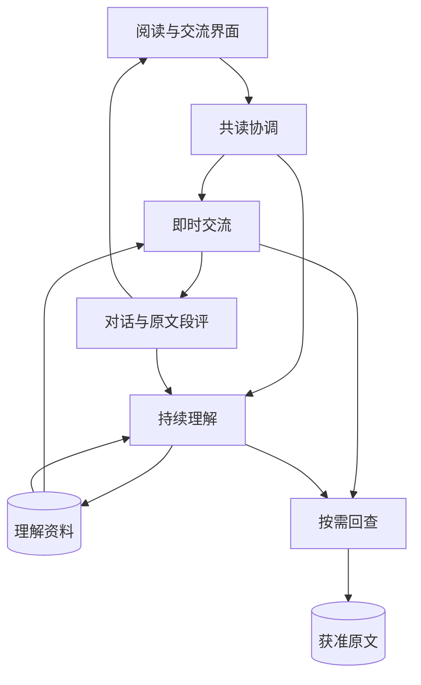

# 宜序伴读 · 架构概览

本文介绍 Yixu Reading Companion 的模块职责与主要数据流。项目处于原型开发阶段，具体实现持续演进。

## 整体结构

| 模块 | 主要职责 |
| --- | --- |
| 阅读与交流界面 | 展示章节、段落、对话和段评，接收阅读位置及用户操作 |
| 共读协调 | 管理内容授权、任务安排、会话状态，以及暂停和结束 |
| 即时交流 | 使用近期获准原文、已有理解与真实交流，回应提问或形成主动评价 |
| 持续理解 | 接收新原文和真实交流，维护完整认识及相关概要 |
| 按需回查 | 根据当前任务取得获准原文或相关理解的详细内容 |
| 保存与接续 | 保存阅读位置、交流、理解和任务结果，承接中断后的继续处理 |

模型服务、内容来源与平台能力通过独立接口接入。界面和平台适配共用共读规则，模型接入与资料保存分别承担各自职责。

## 工程对应

共享核心位于 `src/core/`，模型任务运行位于 `src/agent/`。`src/workbench/` 提供浏览器共读界面，`src/platform/` 承接平台能力；本地服务通过通用 HTTP 接口连接模型。`src/native/` 与 `android/` 提供原生平台接口和宿主。

客户端从使用者导入的原文和自行配置的服务开始运行。依赖由 `package-lock.json` 固定，PC 资源通过 TypeScript 和 Vite 构建；原生构建使用独立脚本。

## 一次共读怎样进行

1. **确定材料。**读者打开作品，程序根据阅读位置及明确授权准备可用内容。
2. **参与现场。**即时交流使用当前所需材料；模型可以回应、留下段评或保持安静，需要前文时按需回查。
3. **保存表达。**针对原文的主动评价始终关联对应段落。已经翻过对应页面的主动评价，以原话保存为原段段评；同一条内容沿用同一份发表记录。
4. **更新理解。**后台承接新读到的内容和真实交流，修订相关完整认识，并检查相应概要。
5. **继续阅读。**后续任务使用已保存的理解和交流，必要时展开详细资料。暂停、结束与重新打开沿原有保存记录接续。

## 资料如何组织

- **原文：**保留章节、段落及阅读授权范围，作为回查依据。
- **完整认识：**承载对作品的持续理解，保留出处、变化与版本关系，支持局部修订。
- **概要：**提供整体背景和当前情境，供即时任务选用，并与相关完整认识保持一致。
- **交流与段评：**保存真实作者、回复关系及对应原文，区分已经发表的内容和私人理解。保存段评本身不表示读者已经看过。

## 模型与程序的分工

模型负责形成看法、提出回查需求和生成表达。程序负责提供获准材料、执行工具、保存结果，以及按照阅读位置选择发表方式。

程序核对资料来源、归属和保存关系；观点与表达由模型形成。即时交流和后台理解通过同一套阅读记录承接，交流内容与其后续处理责任一起保存，理解更新及相关概要沿同一维护任务提交。

## 数据与平台边界

阅读记录以本地保存为基础。启用模型服务时，当前任务所需且获准使用的材料经模型接口处理，服务配置与阅读资料分开管理。

不同作品分别管理原文、理解和交流。资料权限贯穿供给、回查与保存；移动端和其他阅读来源的适配沿用相同的边界。
