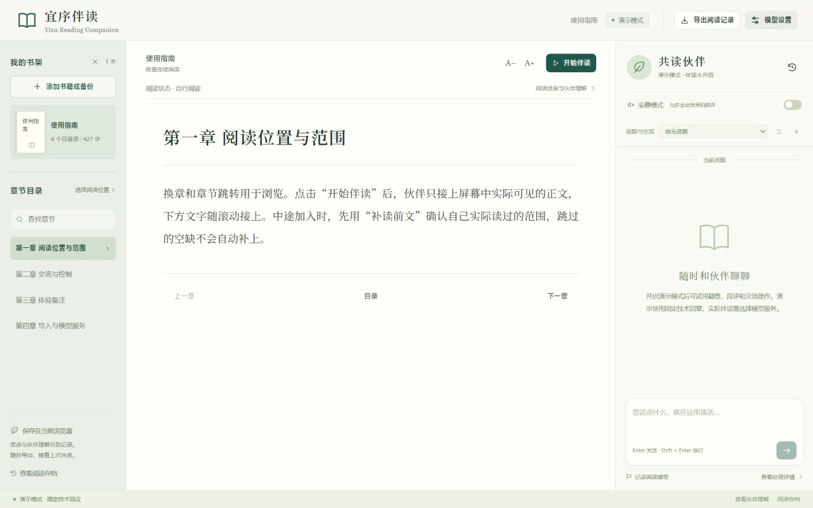

# 宜序伴读

**Yixu Reading Companion**

宜序伴读是一项面向长篇阅读的 AI 伴读项目。伙伴随着读者的阅读进度理解作品、形成看法，并在交流中接续前文与共同讨论。读者可以随时提问、围绕原文交换意见，也可以选择安静共读。

项目处于原型开发阶段，当前重点完善 PC 端的阅读、交流与持续理解流程。工程包含共享核心、PC 共读界面、模型服务接入和 Android 平台源码。



## 启动 PC 客户端

### Windows 便携包

从 [Releases](https://github.com/Areebol9/yixu-reading-companion/releases) 下载 Windows x64 ZIP，完整解压后双击 **`启动宜序伴读.cmd`**。便携包内置 Node.js 和运行依赖，解压即可启动。

运行环境为 Windows 10 / 11 x64，并已安装 Microsoft Edge 或 Google Chrome。客户端使用浏览器的独立窗口，资料保存在解压目录下的 `.local/`；升级时请保留该目录。下载页同时提供 SHA-256 校验文件。

### 从源码运行

环境要求：Node.js 24 或更新版本。

```bash
npm ci --ignore-scripts
npm run build
npm run workbench
```

打开 <http://127.0.0.1:4323/workbench.html>。Windows 安装依赖并完成构建后，也可双击 **`启动宜序伴读.cmd`**，通过 Edge 或 Chrome 的独立窗口使用客户端。启动器优先使用 PowerShell 7，也兼容系统自带的 Windows PowerShell；浏览器资料单独保存在 `.local/client-browser`。

导入自己有权使用的 TXT 文件，在模型设置中填写兼容接口的服务地址、模型和凭据，保存并启用后开始伴读。默认提供离线界面演练；阅读资料和服务配置由使用者自行添加。

后端端口可通过环境变量 `YIXU_PORT` 或 `YIXU_WORKBENCH_PORT` 设置，前者优先。按 `Ctrl+C` 结束本地服务。

独立窗口入口会复用它能确认归属的本项目服务，或在后台启动服务。关闭阅读窗口后，本地服务继续可用；若此前通过终端启动而入口无法确认归属，先在原终端按 `Ctrl+C`，再双击启动。

开发时可在两个终端分别运行 `npm run bridge` 和 `npm run dev`，打开 <http://127.0.0.1:5174/workbench.html>。开发端口可用 `YIXU_DEV_PORT` 设置，端口被占用时启动会停止。

制作 Windows 便携包：安装依赖后运行 `pwsh -File scripts/package-client.ps1`。脚本构建客户端、下载并校验固定版本的官方 Node.js，生成的 ZIP 和 SHA-256 校验文件位于 `artifacts/`。

## 关注的阅读体验

| 场景 | 设计方向 |
| --- | --- |
| 一起读下去 | 跟随真实章节和段落，在读者授权的已读范围内参与交流 |
| 随时聊几句 | 围绕眼前内容、人物和此前讨论接话，由伙伴决定是否主动表达 |
| 在原文旁留注 | 将评价关联到具体段落，支持回看、回复和继续讨论 |
| 接得上长篇故事 | 持续更新对人物、关系和情节的理解，需要时回查已读原文 |
| 按自己的节奏阅读 | 提供安静、暂停、结束和保存后接续等控制 |

## 设计原则

- **以读者进度为边界。**浏览位置、授权内容和已完成的理解分别管理，模型按实际获准材料工作。
- **保留观点与出处。**作品原文、人物说法、读者观点和伙伴判断各有归属；伙伴的看法可以随阅读变化。
- **让交流与理解相互承接。**即时交流关注当前阅读，后台持续整理认识，真实讨论进入后续理解。
- **让表达留在合适的位置。**针对某段形成的主动评价，返回时若已翻过该页，就以原话留作对应段评。
- **尊重阅读节奏。**伙伴可以表达，也可以安静。段评保存在本项目的阅读记录中，由读者选择何时查看。

## 当前方向

当前开发围绕 PC 阅读原型推进，重点是即时交流、持续理解、按需回查以及保存与接续。移动端适配、语音交互与更多阅读来源属于后续建设方向。

系统按界面、共读协调、理解资料和外部服务划分职责，便于各部分独立演进。详细说明见[架构概览](ARCHITECTURE.md)。

## 代码结构

| 目录 | 内容 |
| --- | --- |
| `src/core/`、`src/agent/` | 共读、持续理解、资料回查与模型任务执行 |
| `src/workbench/`、`src/platform/` | PC 阅读界面、存储及平台接入 |
| `src/native/`、`android/` | 原生运行接口与 Android 平台源码 |
| `scripts/`、`tests/` | 运行、构建脚本与技术测试 |
| `third_party/` | 保留的第三方组件、许可与必要署名 |

Android 构建另需 Java、Android SDK、NDK 及原生语音依赖，入口为 `scripts/build-android.ps1`。移动端的适配与交付持续推进。

## 许可与商业授权

本项目自有源码采用 **GNU GPL v3（GPL-3.0-only）**，完整条款见 [LICENSE](LICENSE)。可以按照 GPLv3 使用、修改及分发，包括符合其条件的商业使用和发行。

对于需要按其他条件使用或分发本项目自有代码的需求，可向项目权利人申请另行商业授权。具体范围、条件及费用以单独书面协议为准。本说明本身不授予 GPLv3 之外的权利。

第三方组件与明确标注的改写内容继续遵守各自许可，相关文本和署名保留于 `third_party/` 及相应依赖中。人格提示词的改写许可见 [Nano Bear 署名说明](third_party/nanobear/NOTICE.md)。另行商业授权仅覆盖权利人有权再授权的部分。
